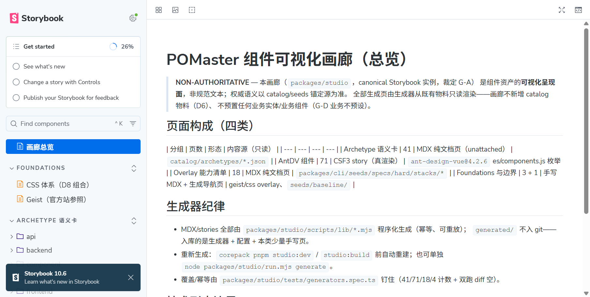

# POMaster

[](https://github.com/River-Singer/POMaster_VNext/actions/workflows/ci.yml)
[](https://www.npmjs.com/package/pomaster)
[](./LICENSE)

POMaster 是给「由 AI Agent 写代码」的软件项目用的命令行工具。它在项目里维护一份结构化的项目状态（`.pomaster/`），Agent 每次开工前从这份状态里取上下文，写代码前要有许可，宣称完成前要拿出真实工具跑出来的证据。人只在少数几个点上做决定：需求定没定、基线认不认、结果收不收。

它不改你的构建、不替你选技术栈，也不包一层 prompt。它做的事情是记账和判卷：什么是当前事实、谁被允许改什么、哪些结论有证据。

## 它要解决的问题

让 Agent 连续开发一个项目，常见的失败不是「写不出代码」，而是：

- **上一轮的说法被当成事实。** 上个会话说「27 个页面做完了」，实际有一半是空壳；下一个会话在这个前提上继续做。
- **基线悄悄变了。** 依赖、目录、接口约定在没人确认的情况下被改掉，过几周才发现。
- **报绿不等于验证过。** 测试没跑、跑了没断言、工具没装都显示成「通过」。一个报绿但没有证据的工具，比没有工具更危险，因为它把「不知道」变成了「已确认没问题」。
- **规范越写越多，没人读。** 几百份 Markdown 规范塞进项目，Agent 每次只读到一部分，人也不再看。

POMaster 的做法是：不再把规范文档当成治理对象，而是治理「项目当前状态」本身；文档、上下文、Storybook 页面都只是这份状态的投影。

## 工作原理

### 1. 状态是唯一的事实来源

`.pomaster/` 里存的是一组治理对象（页面、能力、接口、任务、变更、决策……）。每个对象有：

- 四个状态轴：生命周期（提议 / 当前 / 退役…）、可信度、证据程度、变更态；
- 一个权威（谁能对它下结论，缺省是项目 Owner）；
- 完整的变更记录（journal 只追加）。

所有写入都走一个入口：`pomaster maintain` 提交事务，kernel 判卷后落盘。Agent 不直接改状态文件；改了也会被一致性检查发现。Markdown 文档、AGENTS.md、Agent 拿到的上下文，都是从这份状态生成的，不是第二个事实来源。

### 2. 写代码之前要有许可

一个任务开工前，Owner 签一个许可（permit）：这次允许碰哪些对象。Agent 声明执行身份（`execution begin`）后，宿主的写前钩子（`exec-guard`）对每次写文件做判断：这个文件绑定的对象在不在许可范围里。不在就拦下，并指出该去扩大许可还是换个改法。钩子只判断、不写文件；判卷器自身出故障时放行并留下记录，事后由 `execution audit` 复查，不会把开发卡死。

### 3. 结论要有证据

「验证通过」不能由 Agent 自己说。验证要跑真实工具（构建、类型检查、lint、契约检查、浏览器检查……），每次运行生成一张收据（GRN，记下工具、版本、扫描了多少、违规多少）。一条验收（claim）必须绑定收据；再由另一个主体复核（verification）；最后 `closeout` 逐条核对「验收 × 收据」，缺一条就不让任务完成。

几条硬规则贯穿所有判卷：

- 工具没装、没跑：记 `not_run`，不是通过；
- 门禁不适用（比如项目没有用到它）：记 `not_configured`，并写明原因；
- 参数还没定（比如设计规范里的某个取值还是待决定）：记「待定」，不按默认值判；
- 判卷器不信工具自报的结果，按扫描数与违规数重新算一遍，对不上就降级。

### 4. 上下文按任务投影

Agent 每次开工拿到的不是全部规范，而是按当前任务的阶段、触发条件和技术栈挑出来的那部分（`context compile`），每条都写明为什么被选中。经验和建议放在单独的区域，不和硬规则混在一起。

### 5. 一个任务怎么走

从一句需求到完成，只有一条公开通路，每一步都有对应命令，`pomaster next-action` 会告诉 Agent 现在该做哪一步、加载哪张技能卡：

| 阶段 | 做什么 | 命令 |
|---|---|---|
| ① 需求 | 先读仓库和已有对象，再追问；产出的是一张决策图（每个决策点、选项、依据），收敛由机器判断 | `brainstorm` |
| 建任务 | 决策图收敛后提升为任务，验收条目随之生成 | `brainstorm promote` |
| ② 许可 | Owner 确认这次允许改的范围 | `permit issue` |
| ③ 上下文 | 按任务投影规范与基线 | `context compile` |
| ④ 实现 | 在许可范围里写代码，交接时写清改了什么、还有什么没做 | `exec-guard`、`execution handoff` |
| ⑤ 验证 | 编译验证计划并真实执行，每项一张收据；失败给出分类诊断 | `plan run`、`check`、`finalize` |
| ⑥ 对账 | 只看相对许可的偏差、例外和抽样点 | `reconcile`、`view` |
| ⑦ 折叠 | 更新当前事实，经验入账 | `compact`、`knowledge` |
| ⑧ 收口 | 逐条核对验收与收据，过了才算完成 | `closeout` |

不知道下一步做什么时，问 `pomaster next-action` 或 `pomaster status`。

### 6. Agent 怎么接进来

`pomaster init` 会在项目里装三样东西：AGENTS.md / CLAUDE.md（项目入口说明与能力地图）、一组技能卡（每个阶段一张，Claude Code 与通用 Agent 各一份镜像）、宿主钩子（会话开始注入状态速览，每轮提示附带可行动项，写文件前过 `exec-guard`）。钩子注入的内容都是状态的投影。宿主不支持钩子时，AGENTS.md 里的约定仍然要求 Agent 先跑 `next-action` 再动手。

### 7. 基线与漂移

技术栈、目录约定、设计 token 这类长期决定写在 `.pomaster/baseline/`。Owner 用 `baseline confirm` 确认后，确认时的内容摘要被记下来；之后任何改动都会在 closeout 时被检出（`BASELINE_DRIFT`），要么挂一个变更对象重新确认，要么由 Owner 显式声明。已有项目接入时，init 先建一个「项目识别」任务，让 Agent 从仓库里找证据报告用途、架构、技术栈和未知项，Owner 确认后才回填基线。

## 前端：设计规范、Storybook 与原型转换

前端的规范不再是一堆文档，而是一份结构化的设计规范（`pomaster.design-standard/v1`），同一份源生成三样东西，三样盖同一个指纹：

- **人看的**：Storybook「规范」分区，每条规则有条文、演示、对照表、实验和「这样做 / 别这样做」；
- **AI 读的**：孪生文件（JSON + Markdown），以及 `pomaster design show`；
- **机器判的**：`pomaster design check`。

总 Storybook 里有两个抽屉：**Vue · Ant Design** 与 **React · Geist**。两套体系共用一个目录骨架（领域、条目、组件取并集），内容各是本体系的规范：基础（色彩、字体、圆角、阴影、栅格、间距、动效、点击反馈、焦点环……）、组件、设计模式（体验管理、数据呈现……）和前端工程规范（前端架构、状态管理、性能、安全、会话与 Cookie、防篡改、报错、保护页、页面加载、缓存、异步、高并发、防重复点击）。机制类的规则配了可以动手操作的实验。项目定下体系后只留对应的抽屉，规范页从项目自己的规范生成。



**规范怎么约束代码**：规范里标了 `gate` 的条文都有一条检查。检查不自带阈值，阈值从条文参数读——间距阶梯、字阶、字重、圆角档位、栅格列数、列间距、断点、禁用词、全局状态库都是规范里的数，改了规范，检查跟着变。扫描是静态的（Vue 单文件组件、TSX、样式文件、Tailwind 类），违规给出文件、行列和条文编号。例外要写带理由的逐行豁免；老项目可以先把现有违规记成存量，之后只拦新增。同一个判卷用在三处：`design check`、`check --gates`（作为一张收据）、`closeout`（项目落地了规范才适用）。

**开发中怎么改规范**：`design adopt` 把一套预设落到项目；`design set` 定下待决定的取值（记下谁、哪天、为什么）；开发中定下的新规矩用 `update spec` 落位——界面呈现类写进设计规范对应的领域，其余按硬规范的路由表写进对应主题文档。写入按写入契约：每条规则带齐规则、级别、适用范围、理由、检查方式、正例、反例七个字段，条文不带引用、版本号、时间戳和记录人；改过已有条文后跑 `spec-lint` 复核。

**BA 给的原型怎么用**：BA 交来的 spec 和 HTML 原型，结构、风格各不相同。`prototype ingest` 只抽四层：业务事实（字段、选项、必填、状态、提示）、信息结构（页面、区域、分组、顺序）、交互意图（点什么打开什么）原样保留，样式、栅格、字体、组件长相丢掉；原型里用样式表达的事实（红色星号、删除线、右对齐、固定列）翻译成语义；spec 与原型对不上的地方列成问题。按规范重绘后，`prototype check` 用同一个抽取器读新页面，和原来的事实逐条对账，缺失、改动、新增、调序都为零才算还原。

详见 [docs/design-standard.md](docs/design-standard.md)。在线 Storybook：[river-singer.github.io/POMaster_VNext](https://river-singer.github.io/POMaster_VNext/)。

## 脚手架

一份领域规格（`pomaster.domain-spec/v1`）描述实体、字段、分级和对管理侧 / 用户侧的暴露方式。Owner 确认后，`scaffold generate` 按它生成数据库迁移（只追加，需要数据迁移的变化会被拒绝）、每个部署面一份 OpenAPI、管理侧前端（Vue + ant-design-vue 的列表、编辑抽屉、接口客户端、路由与文案，照设计规范写）。生成的文件记在清单里，手改会被一致性门禁拦下；改规格要重新确认再生成。详见 [docs/scaffold-domain-spec.md](docs/scaffold-domain-spec.md)。

## 设计取舍

- **硬约束少而明确**：不伪造事实、不越权、不静默冲突、不无证据宣称完成。其余的是建议，不是门禁。
- **治理开销跟风险成比例**：没有需要做的治理动作时，零变化就是正确结果（`NO_CHANGE`）。
- **人只审偏差**：许可锁住范围后，人不需要逐行读 Agent 写的代码，只看偏离许可的部分、例外和抽样点。前提是判卷诚实，所以仓库里有一组固定的对抗用例，持续攻击自己的门禁。
- **可以从仓库恢复**：删掉本机缓存、重新克隆、重建运行面，项目认知基本能恢复。
- **本仓库自己也用它管**：开发 POMaster 时，仓库根的 `.pomaster/` 按同一套规则运行。

## 仓库结构

```text
packages/    kernel（状态与判卷）· cli（命令）· gauntlet-lite（工具适配与收据）· schemas（落盘契约）
             studio（Vue · Ant Design 画廊）· studio-react（React · Geist 画廊）——两个画廊不随 npm 发布
catalog/     随包分发的工程物料：规则、知识、门禁定义、传感器、标准件（archetype）、工具绑定；catalog-lock 逐字节对账
references/  概念账本、外部参照索引
tests/       单元 / 集成 / golden / 对抗 / 行为测试；测试数量下限由 CI 棘轮守住，只升不降
benchmarks/  变异测试、宪法回归、整体基准
```

技术栈：TypeScript，Node ≥ 22，pnpm monorepo；状态以 JSON 落盘，版本与回滚交给 Git；外部测试工具一律经适配器接入，不进核心。

## 深入阅读

- [docs/init-reference.md](docs/init-reference.md)：`init` 的产物、目录约定、播种规则、技能卡与钩子、新旧项目两种路径、基线确认
- [docs/kernel-api.md](docs/kernel-api.md)：kernel API
- [docs/design-standard.md](docs/design-standard.md)：设计规范的结构、修改流程、门禁与原型转换
- [docs/scaffold-domain-spec.md](docs/scaffold-domain-spec.md)：领域规格与脚手架生成
- [docs/diagnostic-reporting.md](docs/diagnostic-reporting.md)：报告与严格检查的退出码边界
- [docs/scoped-human-decisions.md](docs/scoped-human-decisions.md)：决策根、基线依赖与证据快照
- [catalog/](catalog/)：工程物料

## License

双许可，source-available，不是 OSI 意义上的开源：

- **PolyForm Noncommercial 1.0.0**：公共许可，只授权非商业使用，全文见 [LICENSE](./LICENSE)；
- **商业授权**：任何商业使用（包括企业内部使用、小企业使用）都需要另签书面授权，见 [COMMERCIAL_LICENSE.md](./COMMERCIAL_LICENSE.md)。

商标见 [TRADEMARKS.md](./TRADEMARKS.md)，贡献条款见 [CONTRIBUTING.md](./CONTRIBUTING.md)，安全问题见 [SECURITY.md](./SECURITY.md)（不走公开 issue），第三方许可见 `legal/`。

## 联系方式

- 商业授权与合作：[allenxujianyang@outlook.com](mailto:allenxujianyang@outlook.com)
- 问题反馈：[GitHub Issues](https://github.com/River-Singer/POMaster_VNext/issues)

## 快速上手

安装后在项目根目录初始化；之后不确定该做什么时运行 `pomaster next-action --json`。每个命令的完整参数见 `pomaster <命令> --help`。

```bash
# 安装（Node ≥ 22）
npm install -g pomaster

# 初始化：新项目指定架构；已有项目直接 init，会先建一个项目识别任务
pomaster init                                   # 新项目：pomaster init --architecture vue|react
pomaster project-identification report/confirm  # 已有项目：Agent 报告用途、架构、技术栈与证据；confirm 只接受 human:<名字>
pomaster status                                 # 对象计数、基线确认态、许可活性
pomaster alerts                                 # 当前可行动项与工作流路由（钩子每轮注入）
pomaster doctor                                 # 工具链与 MCP 是否就绪，缺什么提示装什么
pomaster portability bootstrap/check            # 换机器时重建运行面 / 检查可恢复性
pomaster update spec                            # 不带子命令 = CLI 自更新（--check / --yes）；spec = 把开发中定下的新规范写到设计规范或硬规范（写前按写入契约校验）
pomaster spec-lint                              # 按写入契约复核已有规范条文：引用、版本号、时间戳、记录人逐处报出
pomaster standards [id]                         # 规范的空间与抽屉：九个空间的通用规范，语言 / 框架 / 架构形态 / 产品抽屉，哪些对本项目生效
pomaster baseline set/confirm/retire/unretire   # 回填基线键 / 确认基线 / Owner 标记某项不适用 / 撤销

# ① 需求：追问到可判断的决策图，再提升为任务
pomaster brainstorm start/question-gate/status/decide/promote
pomaster prototype ingest/check                 # BA 原型 → 业务事实与信息结构（ingest）；重绘页面与事实对账（check）

# ② 许可
pomaster permit issue/check/steal/renew/widen/list

# ③ 上下文
pomaster context compile/explain

# ④ 实现
pomaster exec-guard --attempt <file|->          # 写前判断（钩子调用）
pomaster maintain <change-or-task> --ops <tx>   # 提交治理对象事务
pomaster design validate/show/adopt/set/check   # 设计规范：校验 / 查 / 落到项目 / 定取值 / 门禁扫源码
pomaster scaffold validate/confirm/status/plan/generate/check   # 领域规格 → 数据库迁移、OpenAPI、管理侧前端；check = 一致性门禁

# ⑤ 验证
pomaster plan compile/run                       # 编译并执行验证计划，每项一张收据；--diagnose-on-failure 出分类诊断
pomaster control-data-flow analyze [--report-only]   # 控件 → 事件 → 状态 → 回显的数据链审计（Vue SFC / React TSX）
pomaster finalize status/replay-adjudicate/run TASK.*   # 推进验证收尾；独立复核与人工接受处停下等待
pomaster tools list/validate                    # 工具绑定
pomaster check --fast/--gates                   # 局部自检 / 全部门禁定义派发并入账
pomaster record gate-run/claim/verification/requalify   # 收据、验收、复核、证据过期后的重绑
pomaster task reassess-baseline TASK.*          # 基线合法变更后重算任务的基线依赖

# ⑥ 对账
pomaster reconcile --permit <PERMIT.*>
pomaster view blueprint/task/attention/decision/review
pomaster audit blueprint/task/test-weakening
pomaster ledger record/list                     # 例外台账

# ⑦ 折叠与沉淀
pomaster compact
pomaster knowledge search/inspect/record/review-candidates/promote/demote
pomaster memory capture/inspect/harvest/review/promote/audit
pomaster negative-history record/search         # 失败过的做法
pomaster steering record/search                 # 有来源的约束
pomaster provider capabilities                  # 运行时能力与降级说明
pomaster telemetry task                         # 任务指标（不出综合评分）

# ⑧ 收口
pomaster closeout <task-id>

# 检视与横切
pomaster resolve "<need>" [--hints ...]         # 先在已有对象与标准件里找，NO_MATCH 才设计新的
pomaster new-entity check <governed-id> [--need ...]   # 新建对象前的证明
pomaster inspect <governed-id>
pomaster preset preview/drift/applicability
pomaster graph <governed-id> [--view impact]
pomaster recon import-graph|migrations|sbom|architecture-snapshot|token-sources|scripts|openapi|scope-review   # 已有项目的取证
pomaster research list/inspect/request/handoff
pomaster eval --suite behavioral                # Agent 行为评测
pomaster catalog status/explain/relock
pomaster migrate trellis-spec --analyze --spec-root <dir>
pomaster production band/evaluate/challenge/diagnose/metrics/self-improvement
pomaster agents status/dispatch-pack
pomaster run <task>
pomaster handoff <task> --to <role>
pomaster session attach/refresh/list            # 不带子命令 = 会话开场的状态速览
pomaster lock acquire/heartbeat/release/steal/list
pomaster execution begin/attach-permit/handoff/end/list/audit
pomaster next-action [--task <TASK.*>] [--session-key <key>] --json   # 当前该做哪一步、加载哪张技能卡
pomaster trace show/list
pomaster checkpoint save/show
pomaster diagnose "<症状>"                       # 关联已有证据给出诊断计划，不自动修复

# Storybook（在本仓库内）
# corepack pnpm studio:dev          两个抽屉的总 Storybook（http://localhost:6008）
# corepack pnpm studio:vue:dev      只起 Vue · Ant Design（6006）
# corepack pnpm studio:react:dev    只起 React · Geist（6007）
```
